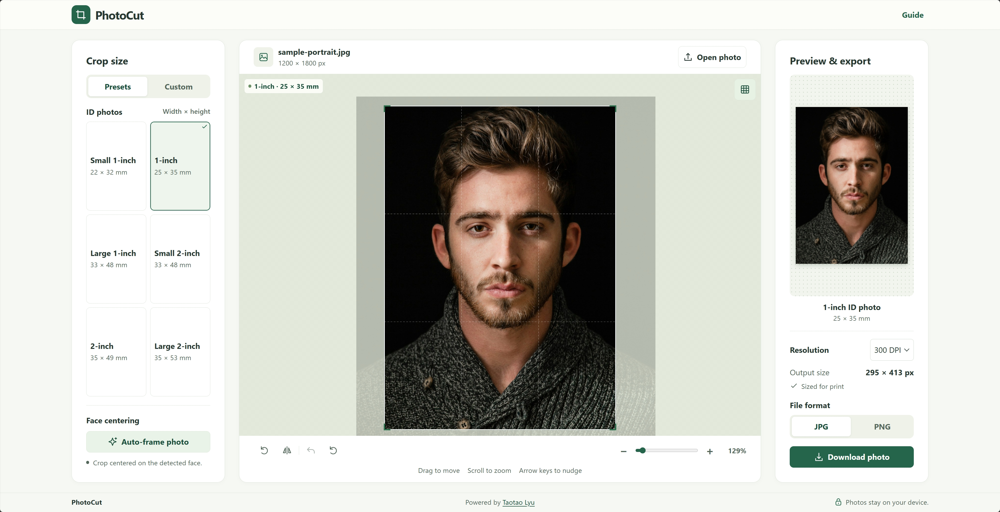

  

<h1 align="center">PhotoCut</h1>

A simple, lightweight tool for cropping ID photos in your browser.

<!-- Replace the placeholder URL below with the live PhotoCut website. -->

  <strong><a href="https://taotaolyu.github.io/PhotoCut/">Try PhotoCut</a></strong>

## From photo to finished crop

- **Choose the size.** Pick a common ID photo preset, enter dimensions in millimeters or pixels, or set an aspect ratio.
- **Fine-tune the framing.** Center the crop on a detected face, then drag, zoom, rotate, or flip while checking the live preview.
- **Export from the original.** Download a JPG or PNG at 150, 300, or 600 DPI, or keep the original pixels within the crop.

**PhotoCut does not collect any data.** All photo processing runs locally in your browser. Large photos use a smaller preview for editing, and the exported crop is drawn from the original image.

## Credits

PhotoCut is licensed under [Apache 2.0](LICENSE). Face detection uses [face-api.js](https://github.com/justadudewhohacks/face-api.js) under the [MIT license](dist/assets/face-api-LICENSE). The sample portrait is by [Joseph Gonzalez on Unsplash](https://unsplash.com/photos/mEZ3PoFGs_k).
